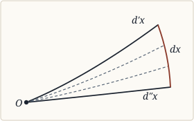

GEOMETOR • bertrand-russell
===========================

**Visit the Online Archive:** https://geometor.github.io/bertrand-russell/

**Bertrand Russell • Foundations of Geometry, Principles of Mathematics (Space) • semantic digital archive**

Mission
-------

``geometor/bertrand-russell`` is part of the interconnected `GEOMETOR <https://geometor.com>`_ semantic digital archive. It provides a dual multi-track Book Codex, analytical vector diagram reconstructions, and cross-corpus philosophical concordance for the foundational geometric treatises of Bertrand Russell. The archive liberates Russell's critical investigations of non-Euclidean metageometry, projective axioms, and the continuity of space from isolated print bounds into addressable semantic units, synchronized companion tracks, primary-source concordance provenance, and exact symbolic connections across the GEOMETOR corpus.

Books in This Archive
---------------------

- `An Essay on the Foundations of Geometry <https://geometor.github.io/bertrand-russell/foundations_of_geometry/>`_ — Complete 1897 Cambridge University Press edition (§§ 1–209), analyzing the history of metageometry, projective and metrical axioms, and philosophical consequences.
- `The Principles of Mathematics <https://geometor.github.io/bertrand-russell/principles_of_mathematics/>`_ — Unabridged 1903 first edition treatment of Part I (Definition of Pure Mathematics) and Part VI (Space, §§ 351–436), addressing projective, descriptive, and metrical geometry.

Repository Contents
-------------------

- ``docsrc/`` — Dual multi-track Book Codex, apparatus, and Sphinx documentation compiled by `PHOTON publish <https://github.com/photon-platform/publish>`_.
- ``resources/`` — SHA-256 verified primary text sources, cross-corpus concordance registries (linking to Hoenen, Euclid, and Pappus), and apparatus datasets.
- ``src/geometor/bertrand_russell/`` — Python modules for diagram synthesis, concordance verification, and deterministic Book Codex compilation.

Local Build & Verification
--------------------------

.. code-block:: bash

   publish build
   uv run --no-sync pytest

Part of the GEOMETOR Knowledge Archive
--------------------------------------

Explore all **74 Book Codices** and **11 Mathematical Catalogs** at https://geometor.com/books/.
