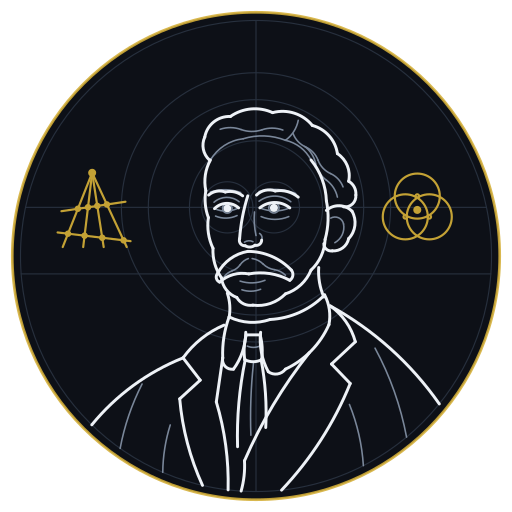

:site_title: Bertrand Russell

.. container:: author-overline

   semantic digital archive • the works of

================
Bertrand Russell
================

:person:`Bertrand Russell <russell>` (1872–1970) stood at the crossroads of nineteenth-century metageometry and twentieth-century logic—first deriving the axioms of projective and metrical space from Kantian *a priori* form in 1897, then overturning that view six years later to rebuild geometry inside the relational logic of pure mathematics. This dual Book Codex gathers both Cambridge University Press first editions complete with synchronized analytical summaries, notes, and cross-corpus concordances.

Books in This Collection
------------------------

.. container:: home-book-hero

   .. container:: home-book-thumb

      .. image:: _static/diagrams/efg-fig-01-p021.svg
         :alt: Geometrical Figure from Bertrand Russell's An Essay on the Foundations of Geometry (1897)
         :target: foundations_of_geometry/index.html

   .. container:: home-book-body

      .. rubric:: First Edition · 1897 (Cambridge) · §§ 1–209 · 9 Diagrams · 3 Tracks

      **An Essay on the Foundations of Geometry** — Russell's expanded Trinity Fellowship dissertation tracing the history of non-Euclidean metageometry (Lobatchewsky, Bolyai, Riemann, Helmholtz, Klein, Cayley) and deducing the projective and metrical axioms from the form of externality, complete with **171 author's footnotes** and **9 vector diagrams**.

      .. container:: home-actions

         * :doc:`Open Foundations of Geometry → <foundations_of_geometry/index>`
         * :doc:`Ch. I: History of Metageometry → <foundations_of_geometry/ch_01/index>`
         * :doc:`Ch. III: Projective & Metrical Axioms → <foundations_of_geometry/ch_03/index>`

.. container:: home-book-hero no-thumb

   .. container:: home-book-body

      .. rubric:: First Edition · 1903 (Cambridge) · Part I & Part VI: Space · §§ 351–436 · 3 Tracks

      **The Principles of Mathematics** — The landmark 1903 logicist manifesto (Preface, Part I Ch. I, and all nine chapters of Part VI *Space*): formalizing projective, descriptive, and metrical geometry after Peano, Cantor, and Pieri, and articulating Russell's celebrated critique of Euclid I.1 and superposition in I.4 (`§§ 389–391`).

      .. container:: home-actions

         * :doc:`Open Principles of Mathematics → <principles_of_mathematics/index>`
         * :doc:`Part VI, Ch. XLIV: Dimensions → <principles_of_mathematics/ch_44/index>`
         * :doc:`Ch. XLVII: Critique of Euclid → <principles_of_mathematics/ch_47/index>`

Key Features
------------

.. container:: home-feature-grid

   .. container:: home-feature-card

      **From Neo-Kantianism to Logicism**

      Compare Russell's 1897 *a priori* defense of space side-by-side with his 1903 relational turn across **305 numbered sections** and dedicated analytical commentaries in :doc:`Evolution (1897–1903) <about/evolution-1897-1903>`.

   .. container:: home-feature-card

      **Hoenen, Heath & Pappus Concordance**

      The :doc:`Cross-Corpus Concordance <concordance>` links Russell's arguments directly to Fr. Peter Hoenen's Thomistic critique (*De Noetica Geometriae*), T. L. Heath's commentary on Euclid, and Pappus's projective cross-ratio.

   .. container:: home-feature-card

      **Calibrated Vector Diagrams & Lexicon**

      Nine interactive SVG reconstructions of Russell's 1897 metageometrical figures pair with **27 technical entries** in the :doc:`Glossary <glossary>` and **44 biographical profiles** in :doc:`People <people/index>`.

Reference & Project
-------------------

.. container:: home-columns

   .. container:: home-col

      .. rubric:: Scholarly Apparatus

      * :doc:`Cross-Corpus Concordance <concordance>` — Bidirectional mapping across Russell, Hoenen, Heath's Euclid, and Pappus
      * :doc:`Glossary <glossary>` — 27 projective, descriptive, metrical, and logicist terms
      * :doc:`People <people/index>` & :doc:`Bibliography <bibliography>` — 44 biographical profiles and 24 primary/secondary editions

   .. container:: home-col

      .. rubric:: About This Project

      * :doc:`About <about/index>` & :doc:`Hoenen Dialogue <about/hoenen-dialogue>` — Scope, Cambridge witnesses, and epistemological debate
      * :doc:`Using This Edition <usage/index>` — Track switching and navigation guide
      * :doc:`Log <log/index>` & :doc:`Modules <modules/index>` — Development notes and Python codex tools

.. toctree::
   :hidden:
   :maxdepth: 2

   foundations_of_geometry/index
   principles_of_mathematics/index
   people/index
   bibliography
   concordance
   glossary
   usage/index
   about/index
   log/index
   modules/index

